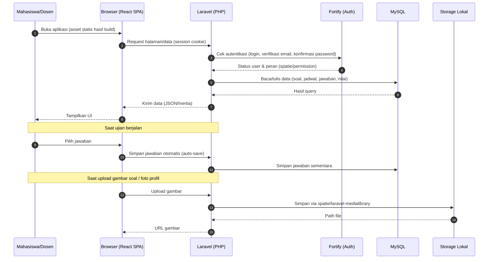
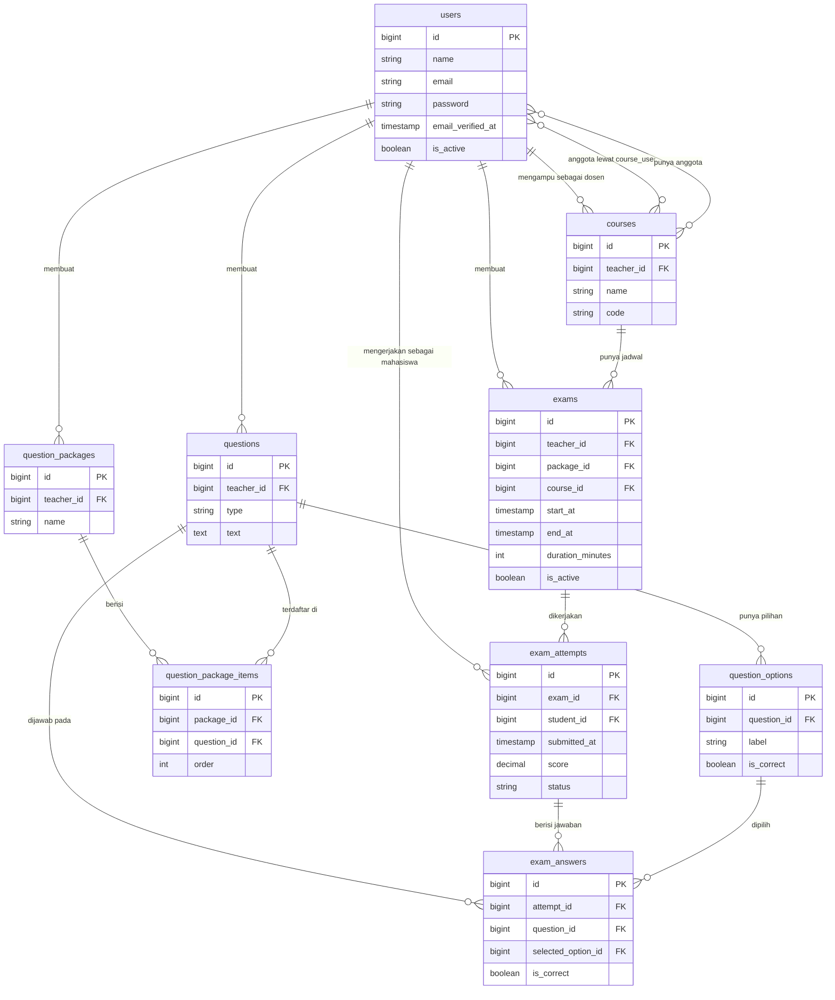

# PRD — Project Requirements Document

## 1. Overview

Aplikasi **CBT (Computer Based Test)** adalah platform ujian online untuk kampus yang mempertemukan dua peran utama: **Dosen** sebagai pembuat soal dan penyelenggara ujian, serta **Mahasiswa** sebagai peserta yang mengerjakan ujian.

**Masalah yang diselesaikan:**

- Ujian masih sering dilakukan manual (kertas/LMS seadanya) sehingga merepotkan saat menyusun soal, menjadwalkan, mengawasi, dan mengoreksi.
- Data soal, jadwal, dan nilai tersebar di banyak tempat sehingga sulit dipakai ulang dan tidak rapi.

**Tujuan utama aplikasi:**

- Menyediakan **satu tempat terpusat** untuk bank soal, jadwal ujian, pelaksanaan ujian, dan nilai.
- Membuat mahasiswa bisa langsung mengerjakan ujian pilihan ganda (mendukung gambar di soal maupun jawaban) dengan timer berjalan dan jawaban tersimpan otomatis.
- Memudahkan dosen membuat soal sekali lalu memakainya berkali-kali lewat Paket Soal, serta memantau nilai kelas dalam satu tabel.

**Prinsip produk:** Rapi, terpusat, dan mudah dipakai — begitu mahasiswa membuka aplikasi, mereka bisa langsung mulai mengerjakan soal.

---

## 2. Requirements

**Fungsional:**

- Autentikasi dengan **Laravel Fortify**: registrasi, login/logout, verifikasi email, konfirmasi kata sandi, dan lupa kata sandi.
- Tiga peran pengguna (**RBAC**):
    - **Admin (super admin):** akses penuh ke seluruh fitur dan data.
    - **Dosen:** kelola soal, kelas (beserta anggotanya), jadwal ujian, lihat nilai, dan ubah profil — terbatas pada data miliknya sendiri.
    - **Mahasiswa:** mengerjakan ujian dan melihat nilainya sendiri.
- Jenis soal: **pilihan ganda (single choice)**, mendukung **gambar pada soal** dan **gambar pada setiap pilihan jawaban**.
- Penyimpanan jawaban **otomatis** selama ujian berjalan agar tidak hilang saat koneksi terputus.
- Ujian punya **batas waktu** (durasi) dan **rentang tanggal** buka/tutup.
- Rekap nilai dan ekspor daftar nilai ke berkas.

**Non-fungsional & Deployment:**

- Aplikasi di-deploy di **shared hosting tanpa Node.js dan tanpa SSH**.
- Seluruh **asset frontend dibuild terlebih dahulu di lokal** (Vite) lalu diunggah sebagai file statis.
- **Tidak menggunakan SSR** — hanya aplikasi sisi klien yang mengambil data dari server.
- Database: **MySQL**.
- Aman: password di-hash, email terverifikasi, proteksi CSRF (bawaan Laravel), dan pembatasan akses ketat per peran.
- Perangkat: wajib responsif (mobile & desktop), minimal Chrome/Firefox/Edge versi modern.

---

## 3. Core Features

Fitur dikelompokkan sesuai fase pada Roadmap yang telah disetujui. **Fase 1 difokuskan pada fondasi autentikasi, RBAC, dan pengelolaan pengguna** — meliputi **Masuk & Daftar Akun**, **Hak Akses**, dan **Kelola Pengguna**. Fitur ujian (bank soal, jadwal, pengerjaan) dan fitur nilai baru dikerjakan setelah fondasi ini selesai.

### Fase 1 — Fondasi: Autentikasi, RBAC & Pengguna

**Masuk & Daftar Akun** _(high)_ — Pengguna membuat akun, memverifikasi email, dan masuk ke aplikasi dengan aman.

- **Daftar Akun** — Membuat akun baru dengan email dan kata sandi.
- **Verifikasi Email** — Memastikan email benar-benar aktif lewat tautan verifikasi.
- **Login & Logout** — Masuk dan keluar dari aplikasi dengan aman.
- **Lupa Kata Sandi** — Memulihkan akun saat kata sandi terlupa.

**Hak Akses** _(high)_ — Setiap peran hanya bisa membuka menu dan data yang menjadi haknya.

- **Peran Pengguna** — Menentukan siapa berperan sebagai admin, dosen, atau mahasiswa.
- **Batasan Dosen** — Dosen hanya mengelola soal, kelas, jadwal ujian, dan nilai miliknya sendiri.
- **Batasan Mahasiswa** — Mahasiswa hanya bisa mengerjakan ujian dan melihat nilainya sendiri.

**Kelola Pengguna** _(high)_ — Admin dan dosen mengatur data mahasiswa, dosen, dan kelas beserta anggotanya.

- **Data Mahasiswa** — Menambah, mengubah, dan menonaktifkan akun mahasiswa.
- **Data Dosen** — Menambah, mengubah, dan menonaktifkan akun dosen.
- **Impor Data** — Memasukkan banyak akun sekaligus dari satu berkas.
- **Kelas & Anggota** — Mengatur kelas dan mahasiswa yang tergabung di dalamnya.

### Fase 2 — Inti CBT

**Kerjakan Ujian** _(high)_ — Mahasiswa mengerjakan ujian pilihan ganda langsung di layar dengan gambar dan waktu berjalan.

- **Daftar Ujian Aktif** — Melihat ujian yang sedang dibuka beserta durasi dan batas waktunya.
- **Layar Soal** — Menampilkan soal pilihan ganda lengkap dengan gambar pada soal maupun jawaban.
- **Timer & Simpan Otomatis** — Menghitung sisa waktu dan menyimpan jawaban otomatis agar tidak hilang.
- **Kumpulkan Jawaban** — Mengirim seluruh jawaban dan menampilkan konfirmasi ujian selesai.

**Bank Soal** _(high)_ — Dosen membuat dan merapikan kumpulan soal untuk dipakai pada ujian.

- **Daftar Soal** — Melihat dan mencari semua soal yang pernah dibuat.
- **Tambah & Edit Soal** — Membuat soal pilihan ganda beserta gambar pada soal atau pilihan jawaban.
- **Paket Soal** — Mengelompokkan soal menjadi satu set ujian yang siap dipakai.
- **Hapus & Duplikat Soal** — Menghapus atau menyalin soal agar bisa dipakai ulang dengan cepat.

### Fase 3 — Jadwal & Nilai

**Jadwal Ujian** _(high)_ — Dosen mengatur kapan ujian dibuka, siapa pesertanya, dan berapa lama pengerjaannya.

- **Buat Jadwal** — Menentukan ujian baru dengan nama, kelas, dan paket soalnya.
- **Atur Waktu & Durasi** — Mengatur tanggal mulai, batas akhir, dan lama pengerjaan ujian.
- **Peserta Ujian** — Memilih kelas atau mahasiswa yang berhak mengikuti ujian.
- **Buka & Tutup Ujian** — Membuka atau menutup akses ujian secara manual di luar jadwal.

**Lihat Nilai** _(medium)_ — Dosen dan mahasiswa melihat hasil ujian beserta rincian jawabannya.

- **Nilai Saya** — Mahasiswa melihat nilai dan status kelulusan dari ujian yang dikerjakan.
- **Rekap Nilai Kelas** — Dosen melihat daftar nilai seluruh mahasiswa di kelasnya dalam satu tabel.
- **Detail Jawaban** — Melihat rincian jawaban benar dan salah untuk setiap soal.
- **Unduh Nilai** — Mengekspor rekap nilai ke berkas agar mudah diarsipkan.

### Fase 4

**Profil Saya** _(low)_ — Setiap pengguna mengatur data pribadi dan keamanan akunnya sendiri.

- **Ubah Data Diri** — Memperbarui nama, kontak, dan informasi pribadi lainnya.
- **Foto Profil** — Mengunggah atau mengganti foto yang tampil di akun.
- **Ganti Kata Sandi** — Mengubah kata sandi dengan konfirmasi sandi lama.

---

## 4. User Flow

**A. Masuk & Daftar Akun (Semua Peran)**

1. Pengguna membuka aplikasi → diarahkan ke halaman **Login**.
2. Jika belum punya akun → klik **Daftar**, isi nama, email, dan kata sandi.
3. Sistem mengirim **email verifikasi**; pengguna mengklik tautan di email.
4. Setelah email terverifikasi → pengguna bisa **Login**.
5. Jika lupa kata sandi → klik **Lupa Kata Sandi** → masukkan email → tautan reset dikirim.

**B. Alur Dosen (Fase 1 → 2 → 3 → 4)**

1. Login sebagai Dosen → masuk ke **Dashboard**.
2. **Buat Bank Soal**: tambah soal pilihan ganda (dengan gambar opsional), atur jawaban benar, simpan.
3. Susun soal ke dalam **Paket Soal**.
4. **Buat Jadwal Ujian**: pilih paket soal, kelas, tanggal buka/tutup, dan durasi.
5. Pantau **Rekap Nilai Kelas** setelah mahasiswa mengumpulkan jawaban.
6. Lihat **Detail Jawaban** tiap mahasiswa, lalu **Unduh Nilai** bila perlu arsip.
7. Kelola **Kelas & Anggota** dan data mahasiswa pada kelasnya.
8. Ubah **Profil Saya** kapan saja.

**C. Alur Mahasiswa (Fase 1 → 2 → 4)**

1. Login sebagai Mahasiswa → **Daftar Ujian Aktif** tampil.
2. Pilih ujian → klik **Mulai Kerjakan**.
3. **Layar Soal** muncul dengan **Timer** berjalan; setiap jawaban **tersimpan otomatis**.
4. Klik **Kumpulkan Jawaban** → konfirmasi → ujian selesai.
5. Buka **Nilai Saya** untuk melihat hasil dan status kelulusan, serta **Detail Jawaban** bila diizinkan dosen.
6. Ubah **Profil Saya** bila ingin update data diri / foto / kata sandi.

**D. Alur Admin**

1. Login sebagai Admin → akses seluruh menu.
2. Kelola **Data Dosen**, **Data Mahasiswa**, dan **Impor Data** massal.
3. Atur **Kelas & Anggota**.
4. **Hak Akses**: tetapkan peran setiap pengguna.
5. Memantau seluruh data bank soal, jadwal, dan nilai di seluruh kelas.

---

## 5. Architecture

Secara garis besar, aplikasi berjalan sebagai satu paket Laravel yang melayani:

- Halaman web & API internal (menggunakan **Inertia.js** sebagai jembatan dengan React).
- Autentikasi via **Laravel Fortify** (session-based, cocok untuk shared hosting).
- File asset frontend sudah **dibuild lokal** (Vite) dan diunggah ke server sebagai file statis — **tanpa SSR, tanpa Node.js di server**.
- Data disimpan di **MySQL**; file (gambar soal, foto profil) disimpan lewat **spatie/laravel-medialibrary** di storage lokal.

---

## 6. Database Schema

Berikut tabel-tabel utama. Nama kolom `timestamps` mencakup `created_at` & `updated_at`.

**users** — semua pengguna aplikasi (admin, dosen, mahasiswa)

- `id` (bigint, PK)
- `name` (string) — nama lengkap
- `email` (string, unique) — email login
- `email_verified_at` (timestamp, nullable) — bukti verifikasi email
- `password` (string) — hash kata sandi
- `phone` (string, nullable) — nomor kontak
- `is_active` (boolean) — status akun aktif/nonaktif
- `timestamps`

**roles, permissions, model_has_roles, model_has_permissions, role_has_permissions** — tabel bawaan **spatie/laravel-permission** untuk memetakan peran (admin/dosen/mahasiswa) dan izin per fitur.

**courses (Kelas)** — kelas yang diampu dosen

- `id` (bigint, PK)
- `teacher_id` (bigint, FK → users.id) — dosen pengampu
- `name` (string) — nama kelas
- `code` (string, unique) — kode kelas
- `description` (text, nullable)
- `timestamps`

**course_user** — anggota mahasiswa di sebuah kelas (pivot)

- `course_id` (bigint, FK → courses.id)
- `user_id` (bigint, FK → users.id)
- `timestamps`

**questions (Soal)** — bank soal

- `id` (bigint, PK)
- `teacher_id` (bigint, FK → users.id) — pembuat soal
- `type` (string, default `single_choice`)
- `text` (text) — isi soal
- `explanation` (text, nullable) — pembahasan
- `difficulty` (string, nullable) — mudah/sedang/sulit
- `timestamps`

**question_options (Pilihan Jawaban)** — opsi A/B/C/D dst.

- `id` (bigint, PK)
- `question_id` (bigint, FK → questions.id)
- `label` (string) — A, B, C, D
- `text` (text) — isi pilihan
- `is_correct` (boolean) — apakah jawaban benar
- `timestamps`

**question_packages (Paket Soal)** — kumpulan soal untuk satu ujian

- `id` (bigint, PK)
- `teacher_id` (bigint, FK → users.id)
- `name` (string)
- `description` (text, nullable)
- `timestamps`

**question_package_items** — relasi paket ↔ soal

- `id` (bigint, PK)
- `package_id` (bigint, FK → question_packages.id)
- `question_id` (bigint, FK → questions.id)
- `order` (integer) — urutan tampil
- `timestamps`

**exams (Jadwal Ujian)**

- `id` (bigint, PK)
- `teacher_id` (bigint, FK → users.id)
- `package_id` (bigint, FK → question_packages.id)
- `course_id` (bigint, FK → courses.id)
- `name` (string)
- `start_at` (timestamp) — waktu buka
- `end_at` (timestamp) — waktu tutup
- `duration_minutes` (integer) — durasi pengerjaan
- `is_active` (boolean) — override buka/tutup manual
- `shuffle_questions` (boolean) — acak soal
- `show_result` (boolean) — tampilkan nilai ke mahasiswa
- `timestamps`

**exam_attempts (Pengerjaan Ujian)**

- `id` (bigint, PK)
- `exam_id` (bigint, FK → exams.id)
- `student_id` (bigint, FK → users.id)
- `started_at` (timestamp)
- `submitted_at` (timestamp, nullable)
- `score` (decimal, nullable) — nilai akhir
- `status` (string) — `in_progress`, `submitted`, `graded`
- `timestamps`

**exam_answers (Jawaban Mahasiswa)**

- `id` (bigint, PK)
- `attempt_id` (bigint, FK → exam_attempts.id)
- `question_id` (bigint, FK → questions.id)
- `selected_option_id` (bigint, FK → question_options.id, nullable)
- `is_correct` (boolean, nullable)
- `answered_at` (timestamp)
- `timestamps`

**media** — tabel bawaan **spatie/laravel-medialibrary**, menyimpan gambar soal, gambar pilihan jawaban, dan foto profil.

---

## 7. Tech Stack

| Lapisan             | Teknologi                                                | Alasan                                                                                                                          |
| ------------------- | -------------------------------------------------------- | ------------------------------------------------------------------------------------------------------------------------------- |
| Backend             | **Laravel 13**                                           | Ekosistem matang, cocok untuk shared hosting tanpa Node/SSH                                                                     |
| Bahasa              | **PHP 8.5**                                              | Versi PHP yang dipakai aplikasi (lokal maupun shared hosting)                                                                   |
| Dependency PHP      | **Composer 2.10.3**                                      | Manajer dependensi PHP yang dipakai untuk `laravel/*`, `spatie/*`, dst.                                                         |
| Runtime frontend    | **Node v26.9.0**                                         | Hanya dipakai di lokal untuk build asset — tidak ada di server                                                                  |
| Package manager     | **pnpm 12.6**                                            | Menggantikan npm bawaan (`pnpm install`, `pnpm build`) untuk semua perintah Node/Vite                                           |
| Autentikasi         | **Laravel Fortify**                                      | Mendukung registration, email verification, password confirmation, reset password                                               |
| Otentikasi tambahan | **Laravel Sanctum** (opsional)                           | Untuk permintaan API dari React bila diperlukan                                                                                 |
| Frontend            | **React + Inertia.js (mode non-SSR)**                    | Satu repo, session auth langsung, tidak butuh SSR                                                                               |
| Styling             | **Tailwind CSS + shadcn/ui**                             | UI modern, cepat, dan konsisten                                                                                                 |
| Build Tool          | **Vite via pnpm** (hanya di lokal)                       | Asset dibuild lokal (`pnpm build`) lalu diunggah sebagai file statis                                                            |
| RBAC                | **spatie/laravel-permission**                            | Kelola peran admin/dosen/mahasiswa & izin per fitur                                                                             |
| Media & Gambar      | **spatie/laravel-medialibrary**                          | Simpan gambar soal, gambar jawaban, dan foto profil                                                                             |
| Impor Data          | **maatwebsite/excel**                                    | Impor massal akun dosen & mahasiswa dari file Excel/CSV                                                                         |
| Ekspor Nilai        | **maatwebsite/excel** (atau **barryvdh/laravel-dompdf**) | Unduh rekap nilai sebagai Excel/PDF                                                                                             |
| Database            | **MySQL**                                                | Sesuai permintaan; didukung penuh di shared hosting                                                                             |
| Deployment          | **Shared hosting cPanel**                                | Upload source Laravel + asset hasil build; jalankan `composer install`/migrasi via cPanel (bukan SSH) atau melalui skrip seeder |

**Catatan deployment (shared hosting, tanpa Node, tanpa SSH):**

1. Jalankan `pnpm install` lalu `pnpm build` di lokal, kemudian unggah folder `public/build` ke server.
2. Unggah source Laravel (tanpa `node_modules` dan tanpa folder cache pnpm) ke server.
3. Set `.env` untuk produksi (`APP_ENV=production`, koneksi MySQL, `FILESYSTEM_DISK=public`).
4. Jalankan migrasi & seeder lewat menu cPanel (Terminal ringan) atau buat route khusus sementara untuk `artisan migrate --seed`.
5. Pastikan `storage` & `bootstrap/cache` writable, dan `php artisan storage:link` sudah dijalankan agar gambar soal/foto profil bisa diakses publik.
